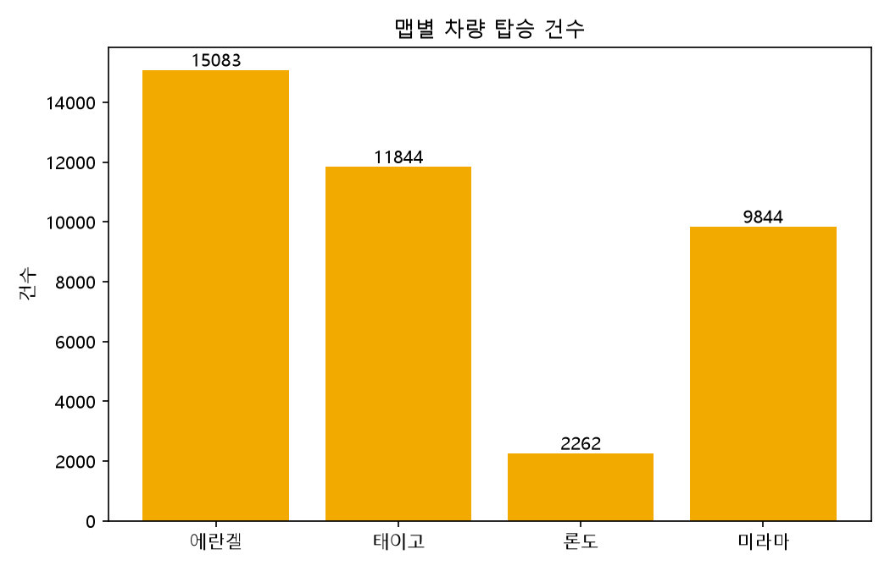
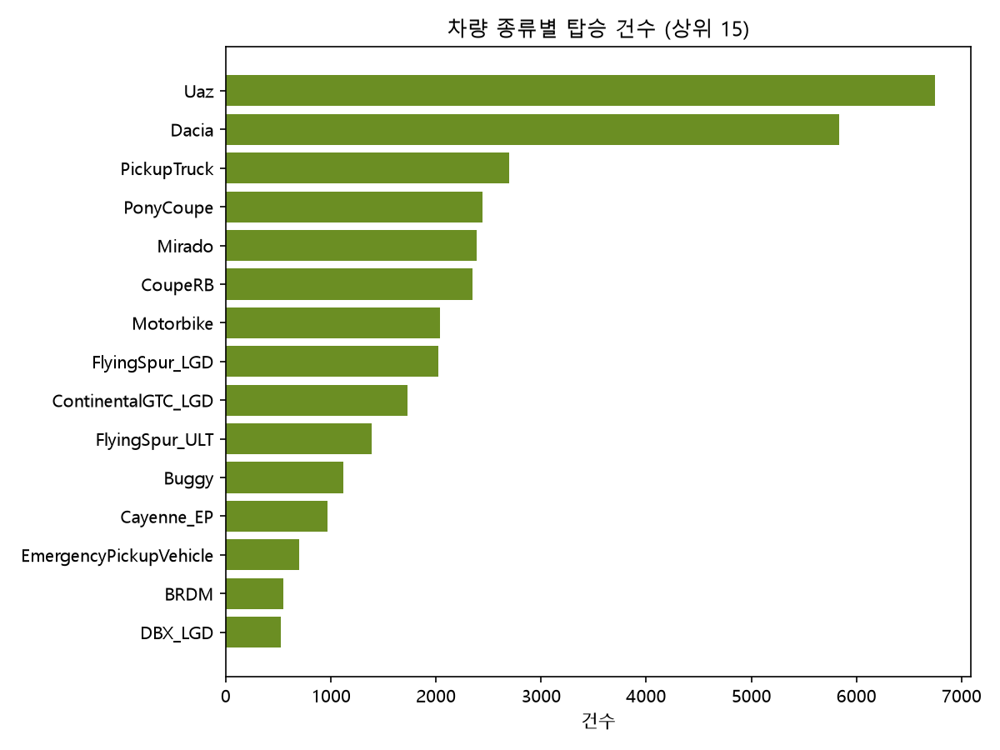
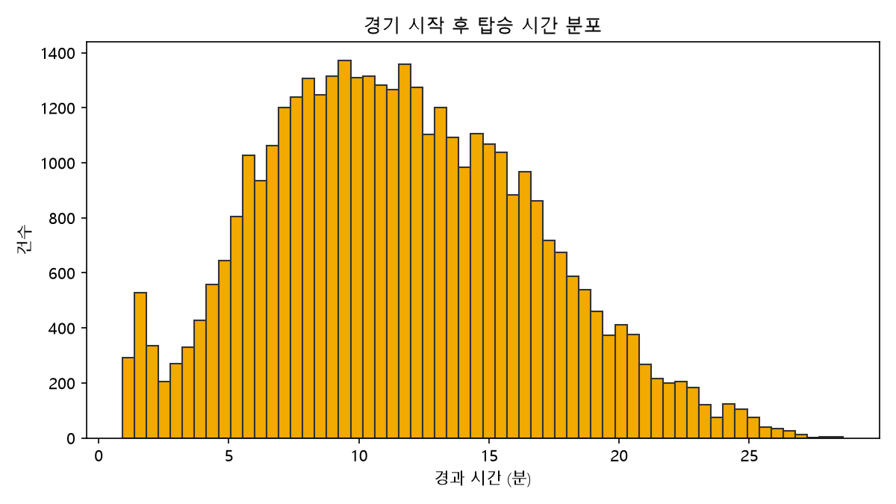
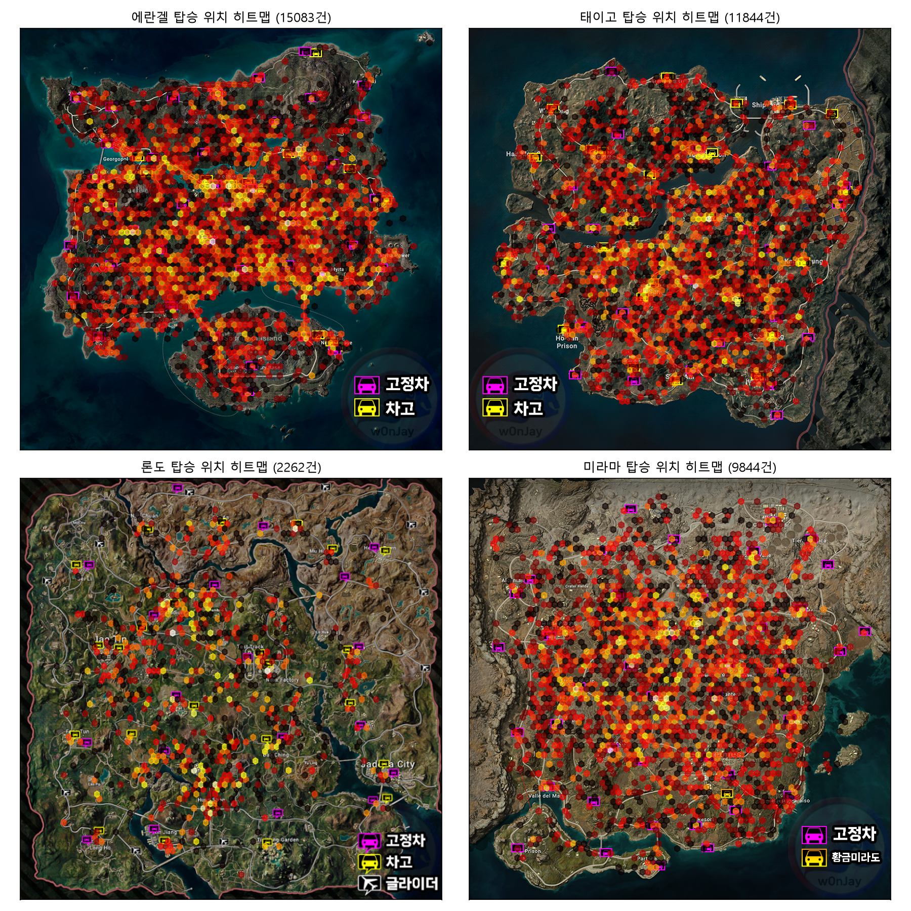
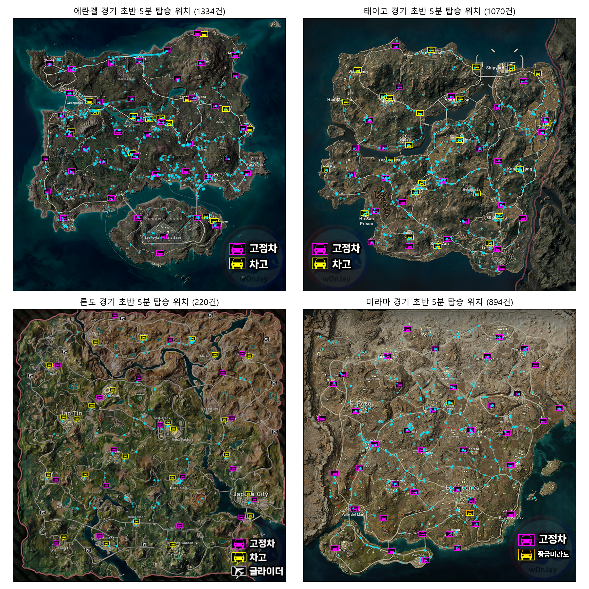

# 📊 배그로그 데이터 분석 보고서 (고정 차량 위치 검증)

배틀그라운드의 **고정 차량**과 **비밀의 방** 위치를 맵별로 한눈에 보여주는 웹 서비스입니다.
여기에 더해, 실제 경기 기록 데이터를 수집·분석해 지도에 표시한 고정 차량 위치가 실제로 맞는지 검증했습니다.

---

## 📌 목차

1. [문제 정의 및 가설](#1-문제-정의-및-가설)
2. [데이터 확보](#2-데이터-확보)
3. [원본 데이터 EDA](#3-원본-데이터-eda)
4. [데이터 라벨링 정의](#4-데이터-라벨링-정의)
5. [데이터 라벨링 과정](#5-데이터-라벨링-과정)
6. [학습 데이터셋 구축](#6-학습-데이터셋-구축)
7. [결론](#7-결론)
8. [웹 서비스 소개 및 실행 방법](#8-웹-서비스-소개-및-실행-방법)

---

## 1. 문제 정의 및 가설

### 문제 정의

배틀그라운드에서 고정 차량과 비밀의 방 위치는 초반 생존과 이동 동선에 큰 영향을 줍니다.
하지만 이 정보는 커뮤니티 글과 영상에 흩어져 있어, 비행기 대기 시간처럼 짧은 순간에 확인하기 어렵습니다.
또한 기존 정보는 대부분 개인 경험에 기반해 있어, 실제로 정확한지 확인할 근거가 부족합니다.

### 가설

> 지도에 표시한 위치에 실제로 고정 차량이 있다면, **경기 초반 차량 탑승은 고정 위치 근처에서 그 이후보다 더 자주 일어날 것이다.**

### 맵별 표시 위치 수

| 맵 | 고정 차량 | 비밀의 방 |
|---|---|---|
| 에란겔 | 40 | 15 |
| 태이고 | 25 | 14 |
| 론도 | 19 | 15 |
| 미라마 | 41 | 15 |
| **합계** | **125** | **59** |

---

## 2. 데이터 확보

### 데이터 출처

- **PUBG 공식 개발자 API** (https://developer.pubg.com)
- 경기별 텔레메트리(Telemetry) 데이터에서 차량 탑승 이벤트를 추출

### 수집 방법

1. 샘플 매치 목록 조회
2. 각 매치의 상세 정보와 텔레메트리 파일 주소 조회
3. 텔레메트리 파일에서 차량 탑승 이벤트만 추출
4. 에란겔, 태이고, 론도, 미라마 4개 맵만 남겨 CSV로 저장

### 수집 항목

| 컬럼 | 설명 |
|---|---|
| `match_id` | 경기 고유 번호 |
| `map_name` | 맵 이름 |
| `vehicle_type` | 차량 종류 |
| `x`, `y` | 탑승 위치 좌표 |
| `elapsed_time` | 경기 시작 후 경과 시간(초) |

### 수집 결과

- 수집 경기 수: **274경기**
- 원본 데이터: **65,328건** (14개 컬럼, 결측치 0건)

### 전처리

| 단계 | 내용 | 남은 건수 |
|---|---|---|
| 원본 수집 | 4개 맵의 전체 차량 탑승 이벤트 | 65,328 |
| 결측치 제거 | 좌표·시간이 없는 기록 제거 | 65,328 |
| 비행기 제거 | 수송기(`DummyTransportAircraft`)·재투입기(`RedeployAircraft`) 탑승 기록 제거 | 39,895 |
| 대기실·비행 단계 제거 | 경기 시작 전 대기실과 비행 단계(isGame ≤ 0.1) 기록 제거 | 39,033 |
| 좌표 이상치 제거 | 플레이 영역(0 ~ 816,000) 밖 좌표, 음수 시간 제거 | 39,033 |
| 중복 제거 | 같은 경기·차량·좌석·좌표·시간 중복 제거 | 39,033 |
| **최종** | | **39,033건** ✅ |

---

## 3. 원본 데이터 EDA

### 3-1. 이상치 분석

처음에는 좌표만 기준으로 이상치를 걸렀는데, 원본의 **39.3%(25,646건)** 가 플레이 영역 밖 좌표였습니다.
네 맵 모두 좌표 범위가 똑같이 약 -169,000 ~ 985,000이어서, 맵 크기 설정 오류가 아니라 지도 바깥의 기록이라고 판단하고 내용을 분석했습니다.

| 이상치 원인 | 건수 | 비율 |
|---|---|---|
| 수송기 탑승 (`DummyTransportAircraft`, isGame 0.1) | 24,753 | 96.5% |
| 대기실 차량 탑승 (isGame 0.0) | 862 | 3.4% |
| 기타 (재투입기 등) | 31 | 0.1% |

게임은 플레이어가 수송기에 오를 때도 "차량 탑승"으로 기록하며, 수송기는 지도 밖에서 출발하기 때문에 좌표가 맵 밖으로 나왔습니다.
이를 근거로 **비행기와 대기실 기록을 이름과 isGame 값으로 직접 제거**하는 단계를 전처리에 추가했고, 그 결과 좌표 이상치와 중복이 모두 0건이 되었습니다.

### 3-2. 맵별 탑승 건수



에란겔이 가장 많고, 론도는 샘플 경기 수가 적어 데이터가 가장 적습니다.

### 3-3. 차량 종류별 탑승 건수



UAZ와 다시아가 가장 많이 탑승되었습니다. 운전석 탑승 비율은 약 55%입니다.

### 3-4. 탑승 시간 분포



경기 시작 후 평균 약 11.6분에 탑승하며, 낙하 직후인 1~2분 구간에 작은 봉우리가 있습니다.
이 초반 탑승은 착지 지점 근처에 미리 있던 차량, 즉 고정 차량일 가능성이 높습니다.

### 3-5. 탑승 위치 히트맵



게임 좌표를 지도 이미지에 겹친 결과, 탑승 위치가 도로를 따라 분포해 좌표 변환이 올바르게 되었음을 확인했습니다.

### 3-6. 경기 초반 5분 탑승 위치



경기 초반 탑승 위치가 지도에 표시한 고정 차량 아이콘 위나 근처에 모이는 모습이 보이며, 이는 가설을 뒷받침하는 시각적 근거입니다.


---

## 4. 데이터 라벨링 정의

전처리된 차량 탑승 기록 39,033건 각각에 아래 두 가지 중 하나의 라벨을 붙였습니다.

| 라벨 | 의미 | 최종 기준 |
|---|---|---|
| `1` | 고정 스폰 차량 탑승 | 경기 시작 후 **5분 이내** 탑승이고, 지도에 표시한 고정 위치에서 **100m 이내**인 경우 |
| `0` | 랜덤 스폰 차량 탑승 | 위 조건에 해당하지 않는 경우 |

- **5분 기준**: 탑승 시간 분포(3-4)에서 낙하 직후 탑승이 몰리는 초반 구간입니다. 이 시점의 차량은 경기 중에 옮겨진 차량이 아니라 처음 생성된 위치에 있을 가능성이 높습니다.
- **고정 위치**: 지도에 표시한 고정차(분홍) 아이콘과 차고(노란) 아이콘을 모두 포함합니다. 차고는 차량이 생성되는 건물이라 고정 차량 위치로 함께 다뤘습니다.
- **100m 기준**: 처음에는 50m로 정했지만, 수작업 검수 결과 사람의 판단과 가장 잘 맞는 거리가 100m여서 수정했습니다. 과정은 5-4, 5-5에 정리했습니다.

---

## 5. 데이터 라벨링 과정

라벨링은 **자동 인식 → 자동 라벨링 → 수작업 검수 → 기준 수정**의 순서로 진행했습니다.

### 5-1. 고정 위치 좌표화 (이미지 자동 인식)

지도 이미지에서 분홍색(고정차)과 노란색(차고) 아이콘을 색상으로 자동 인식해 게임 좌표로 변환했습니다.
범례 아이콘은 크기 기준으로 제외했습니다.


| 맵 | 인식한 고정차 | 직접 센 고정차 | 인식한 차고 |
|---|---|---|---|
| 에란겔 | 41 | 40 | 12 |
| 태이고 | 25 | 25 | 22 |
| 론도 | 19 | 19 | 24 |
| 미라마 | 41 | 41 | 2 (황금 미라도) |

고정차 아이콘은 직접 센 수와 125개 중 124개가 일치했습니다. 크기가 작은 일부 차고 아이콘은 인식되지 않았습니다.

### 5-2. 거리 계산

각 탑승 기록에서 가장 가까운 고정 위치까지의 거리를 계산했습니다.


> 그래프의 빨간 점선은 처음 기준인 50m입니다.

| 고정 위치에서 거리 | 초반 5분 탑승 | 5분 이후 탑승 | 차이 |
|---|---|---|---|
| 25m 이내 | 7.6% | 2.3% | 3.3배 |
| 50m 이내 | 15.5% | 7.0% | 2.2배 |
| 100m 이내 | 27.9% | 14.6% | 1.9배 |
| 200m 이내 | 43.1% | 27.2% | 1.6배 |

### 5-3. 1차 자동 라벨링 (50m 기준)

처음에는 "초반 5분 이내 + 고정 위치 50m 이내"를 기준으로 자동 라벨을 붙였습니다. 이 기준으로 라벨 1은 547건이었습니다.

### 5-4. 수작업 검수

기준선 근처(25~100m)라서 판단이 애매한 초반 탑승 기록을 무작위로 뽑아, 검수 전용 화면(`review_app.py`)에서 지도 위 위치를 직접 확인했습니다.
탑승 위치가 아이콘 테두리 안이나 테두리에 닿아 있으면 1, 바깥이면 0으로 판정했습니다.

| 항목 | 결과 |
|---|---|
| 검수한 기록 | 54건 |
| 사람 판정 | 1: 49건 / 0: 5건 |
| 1차 자동 라벨(50m)과 일치율 | **35.2%** |
| 자동 1 → 0 수정 | 2건 |
| 자동 0 → 1 수정 | 33건 |

수정 35건 중 33건이 "자동 0 → 사람 1"이었습니다. 아이콘에서 50~100m 떨어진 기록도 지도에서는 대부분 아이콘 위에 있었는데, **지도 아이콘 하나가 실제 거리로 100m 이상을 차지하기 때문**입니다. 즉 50m 기준이 너무 엄격해서 실제 고정 차량 탑승을 놓치고 있었습니다.

### 5-5. 검수 결과를 반영한 기준 수정

검수한 54건을 정답으로 두고, 기준 거리별로 사람 판정과의 일치율을 비교했습니다.

| 기준 거리 | 사람 판정과 일치율 |
|---|---|
| 25m | 9.3% |
| 50m (1차 기준) | 35.2% |
| 75m | 75.9% |
| **100m (최종 기준)** | **90.7%** |

가장 잘 맞는 **100m를 최종 기준**으로 정해 전체 라벨을 다시 붙였고, 검수한 기록은 사람의 판정을 그대로 사용했습니다.

| 라벨 | 1차 (50m) | 최종 (100m + 검수 반영) |
|---|---|---|
| 1 (고정 스폰) | 547 | **976** |
| 0 (랜덤 스폰) | 38,486 | 38,057 |

> 검수 샘플이 25~100m 구간에서만 뽑혔기 때문에, 100m보다 넓은 기준이 더 나은지는 이번 검수로 확인하지 못했습니다.

---

## 6. 학습 데이터셋 구축

라벨 1은 모두 포함하고, 라벨 0은 그 3배를 무작위로 추출해 불균형을 줄였습니다.

- 파일: `data/dataset.csv`
- 전체: **3,904건** ✅

| 라벨 | 건수 | 비율 |
|---|---|---|
| 1 (고정 스폰) | 976 | 25.0% |
| 0 (랜덤 스폰) | 2,928 | 75.0% |

| 맵 | 라벨 0 | 라벨 1 |
|---|---|---|
| 에란겔 | 1,106 | 427 |
| 태이고 | 900 | 304 |
| 론도 | 191 | 18 |
| 미라마 | 731 | 227 |

| 라벨 출처 | 건수 |
|---|---|
| 자동 라벨 | 3,855 |
| 수작업 검수 | 49 |

| 컬럼 | 설명 |
|---|---|
| `map_name` | 맵 이름 |
| `vehicle` | 차량 종류 |
| `vehicle_type` | 차량 분류 |
| `seat_index` | 좌석 번호 (0 = 운전석) |
| `x`, `y` | 탑승 위치 좌표 (cm) |
| `elapsed_time` | 경기 시작 후 경과 시간 (초) |
| `nearest_dist_m` | 가장 가까운 고정 위치까지 거리 (m) |
| `nearest_type` | 가장 가까운 위치의 종류 (고정차·차고) |
| `label` | 1 = 고정 스폰, 0 = 랜덤 스폰 |
| `label_source` | auto = 자동 라벨, manual = 수작업 검수 |

---

## 7. 결론

### 가설 검증

> 가설: 지도에 표시한 위치에 실제로 고정 차량이 있다면, 경기 초반 차량 탑승은 고정 위치 근처에서 그 이후보다 더 자주 일어날 것이다.

274경기, 39,033건의 차량 탑승 기록을 분석한 결과, **경기 초반 5분 이내 탑승은 고정 위치 25m 이내에서 일어나는 비율이 5분 이후보다 3.3배, 최종 기준인 100m 이내에서는 1.9배 높았습니다.**
고정 위치에 가까울수록 이 차이가 커지는 점에서, 지도에 표시한 위치에 실제로 경기 시작 시점부터 차량이 존재한다는 가설이 지지됩니다.

또한 수작업 검수를 통해 자동 라벨링 기준(50m)이 지도 아이콘 크기에 비해 지나치게 엄격하다는 점을 발견했고, 기준을 100m로 고쳐 사람 판정과의 일치율을 35.2%에서 90.7%로 높였습니다.

### 한계

- **분석 범위**: 비밀의 방은 경기 기록만으로 위치를 확인하기 어려워, 데이터 분석은 고정 차량에 한정했습니다.
- **론도 데이터 부족**: 샘플 경기에서 론도의 비중이 낮아 라벨 1이 18건뿐이며, 론도에 대한 결론은 내리기 어렵습니다.
- **간접 측정**: API는 차량이 생성된 위치가 아니라 플레이어가 탑승한 위치를 제공하므로, 고정 차량 여부를 탑승 위치와 시간으로 추정했습니다.
- **지도 이미지 정밀도**: 아이콘 위치는 지도 이미지 기반이라 수십 m 수준의 오차가 있을 수 있습니다.
- **검수 규모와 범위**: 수작업 검수는 54건, 25~100m 구간에 한정되어 있어 더 넓은 기준의 적합성은 확인하지 못했습니다.

### 향후 계획

- 수집한 탑승 데이터를 웹 서비스 지도에 히트맵으로 표시해, 사용자가 실제 탑승 빈도를 함께 확인할 수 있도록 개선
- 론도 경기를 추가로 수집해 맵 간 데이터 균형 확보
- 100m 이상 구간까지 검수 범위를 넓혀 최적 기준 거리를 더 정확히 결정

---

## 8. 웹 서비스 소개 및 실행 방법

### 주요 기능

- 맵 카드(에란겔·태이고·론도·미라마)를 눌러 맵 선택
- 카테고리 카드(고정 차량·비밀의 방)를 눌러 지도 전환
- 지도 확대·축소 및 드래그 이동
- 위치별 상세 안내와 전술 팁

> (앱 스크린샷 추가)

### 기술 스택

- Python, Streamlit
- Folium, streamlit-folium
- SQLite
- Pillow

### 프로젝트 구조

```
├── app.py               # Streamlit 웹 화면
├── db.py                # SQLite DB 초기화 및 조회
├── collect.py           # PUBG API 데이터 수집
├── eda.py               # 전처리 및 EDA
├── label.py             # 고정 위치 인식 및 자동 라벨링
├── review_app.py        # 수작업 검수 화면
├── build_dataset.py     # 검수 반영, 기준 수정, 데이터셋 구축
├── images/              # 맵별 지도 이미지
├── data/                # 수집·전처리 데이터, 최종 데이터셋
├── eda/                 # EDA 그래프
├── label/               # 라벨링 결과, 검수 자료
└── README.md
```

### 실행 방법

```bash
pip install streamlit folium streamlit-folium pillow requests pandas matplotlib
streamlit run app.py
```

데이터 분석을 처음부터 다시 실행하려면 아래 순서로 실행합니다. `collect.py`는 실행 시 PUBG API 키를 입력받습니다.

```bash
python collect.py
python eda.py
python label.py
streamlit run review_app.py
python build_dataset.py
```
