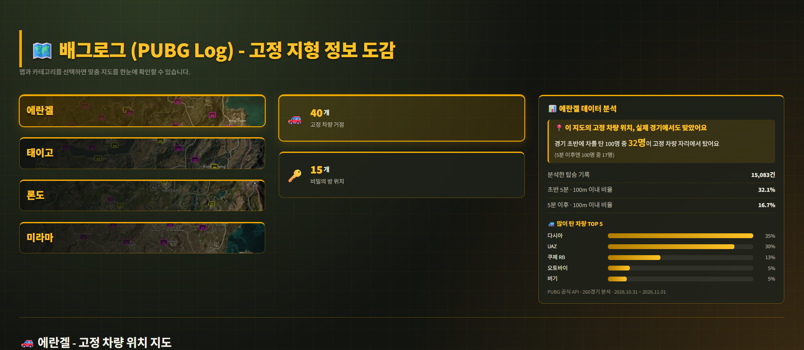
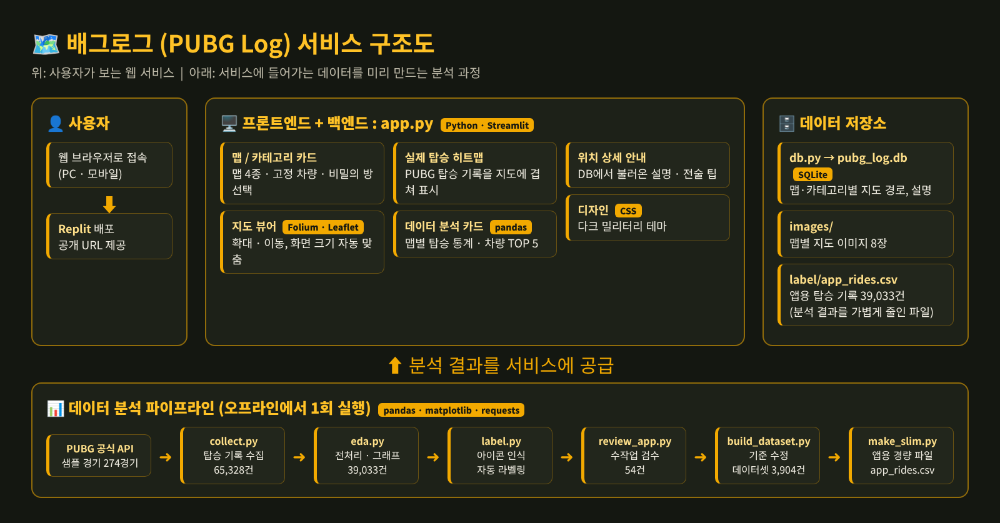
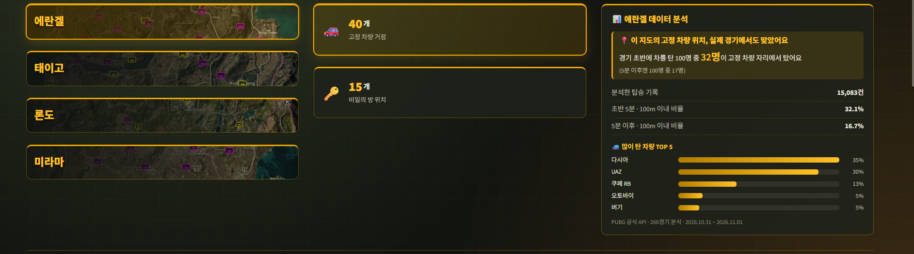
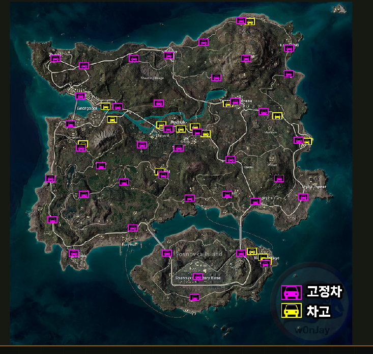
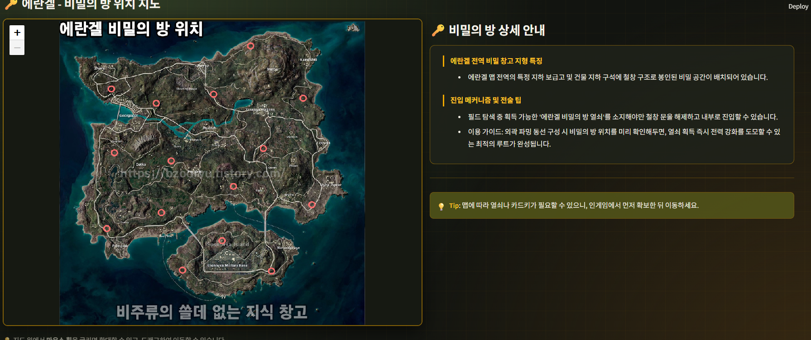
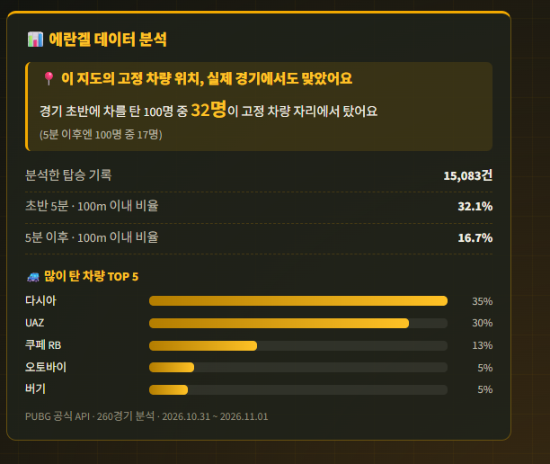
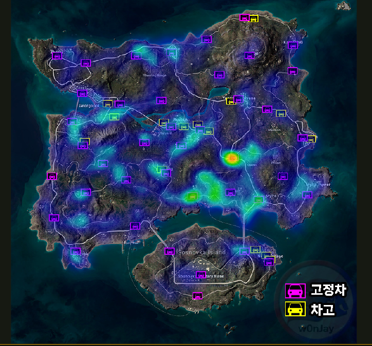
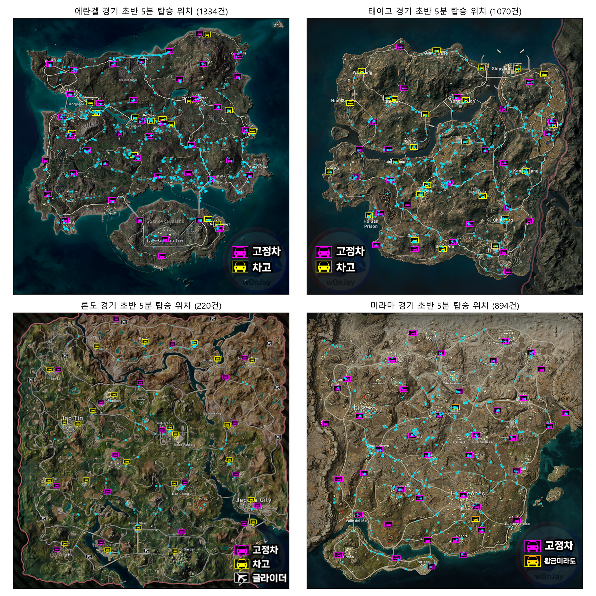

# 🗺️ 배그로그 (PUBG Log) - 배틀그라운드 고정 지형 정보 도감

> 배틀그라운드의 **고정 차량**과 **비밀의 방** 위치를 맵별로 한눈에 보여주고, 실제 경기 데이터로 그 위치를 검증한 웹 서비스입니다.

- 🌐 **서비스 바로가기**: (Replit 배포 URL 입력)
- 🎬 **시연 영상**: (YouTube 링크 입력)
- 📊 **데이터 분석 상세 보고서**: [DATA_ANALYSIS.md](DATA_ANALYSIS.md)



---

## 📌 목차

1. [서론: 개발 배경 및 목적](#1-서론-개발-배경-및-목적)
2. [본론: 서비스 구현 상세](#2-본론-서비스-구현-상세)
3. [결론: 한계와 향후 보완 사항](#3-결론-한계와-향후-보완-사항)
4. [부록: 실행 방법과 폴더 구조](#4-부록-실행-방법과-폴더-구조)

---

## 1. 서론: 개발 배경 및 목적

### 1-1. 개발 동기

배틀그라운드는 경기 시작 후 몇 분 안에 무엇을 먼저 확보하느냐가 생존을 크게 좌우하는 게임입니다.
특히 **차량**은 자기장을 피해 이동하고 교전을 벗어나는 데 꼭 필요하고, **비밀의 방**은 열쇠만 있으면 좋은 장비를 한 번에 얻을 수 있는 곳입니다.

하지만 이 위치 정보는 커뮤니티 글, 블로그, 유튜브 영상에 흩어져 있어서, 비행기 대기 시간처럼 짧은 순간에 원하는 맵의 정보를 찾기가 어렵습니다.
또 대부분 개인 경험을 바탕으로 정리된 정보라 **실제로 맞는지 확인할 근거**가 부족했습니다.

그래서 맵과 카테고리만 누르면 바로 위치를 확인할 수 있고, **실제 경기 데이터로 위치의 신뢰도까지 보여주는** 도감 서비스를 만들게 되었습니다.

### 1-2. 유사 서비스 검토

| 서비스 유형 | 예시 | 장점 | 아쉬운 점 |
|---|---|---|---|
| 인터랙티브 맵 사이트 | PUBG 인터랙티브 지도 사이트 (예: pubgmap.io) | 차량·아이템 위치 레이어를 켜고 끌 수 있음 | 영어 위주라 한국 사용자에게 불편하고, 위치가 실제로 맞는지에 대한 근거는 보여주지 않음 |
| 전적 검색 사이트 | DAK.GG, OP.GG 등 | 개인 전적과 통계가 자세함 | 지도 위치 정보는 거의 다루지 않음 |
| 블로그·커뮤니티 글 | 개인 블로그, 게임 커뮤니티 | 한국어로 자세히 정리됨 | 정보가 흩어져 있고 업데이트 시점이 제각각이며, 한 화면에서 비교하기 어려움 |
| 유튜브 영상 | 고정 차량 정리 영상 | 실제 게임 화면으로 이해하기 쉬움 | 원하는 위치를 찾으려면 영상을 끝까지 봐야 함 |

**배그로그의 차별점**
- 한국어로, 맵과 카테고리를 **카드 클릭 한 번**으로 바로 확인
- PUBG 공식 API의 **실제 경기 274경기, 차량 탑승 기록 39,033건**을 분석해 지도 위치의 신뢰도를 숫자와 히트맵으로 제시

### 1-3. 대상 사용자와 제공 기능

**대상 사용자**
- 배틀그라운드를 시작한 지 얼마 안 되어 맵 지형에 익숙하지 않은 초보 플레이어
- 낙하 지점과 초반 동선을 빠르게 정하고 싶은 일반 플레이어
- 스쿼드에서 동선을 짜는 역할을 맡은 플레이어

**제공 기능**

| 기능 | 설명 |
|---|---|
| 맵·카테고리 선택 | 에란겔, 태이고, 론도, 미라마 4개 맵과 고정 차량·비밀의 방 카테고리를 카드로 선택 |
| 지도 뷰어 | 선택한 지도를 확대·이동하며 확인 |
| 위치 상세 안내 | 위치별 설명과 전술 팁 제공 |
| 데이터 분석 카드 | 맵별 실제 탑승 통계와 많이 탄 차량 TOP 5 |
| 실제 탑승 히트맵 | 실제 경기에서 차량을 탄 위치를 지도 위에 열 분포로 표시 |

---

## 2. 본론: 서비스 구현 상세

### 2-1. 전체 구조



배그로그는 **웹 서비스**와 **데이터 분석 파이프라인** 두 부분으로 나뉩니다.

- **웹 서비스**: 사용자가 접속해서 보는 부분입니다. `app.py` 하나가 화면(프론트엔드)과 데이터 처리(백엔드)를 함께 담당합니다.
- **데이터 분석 파이프라인**: 서비스에 들어갈 통계와 히트맵 데이터를 미리 만드는 부분입니다. 한 번 실행해서 결과 파일을 만들어 두면, 웹 서비스가 그 파일을 읽어서 보여줍니다.

| 구분 | 담당 파일 | 사용 기술 |
|---|---|---|
| 프론트엔드 (화면) | `app.py` | Python, Streamlit, HTML/CSS |
| 지도 표시 | `app.py` | Folium (Leaflet 기반 지도 라이브러리), streamlit-folium |
| 백엔드 (데이터 처리) | `app.py`, `db.py` | Python, pandas |
| 데이터베이스 | `db.py` → `pubg_log.db` | SQLite |
| 데이터 수집·분석 | `collect.py`, `eda.py`, `label.py`, `review_app.py`, `build_dataset.py` | requests, pandas, matplotlib, Pillow |
| 배포 | `.replit`, `requirements.txt` | Replit |

**왜 Streamlit을 선택했나**
Streamlit은 파이썬 코드만으로 웹 화면을 만들 수 있는 프레임워크입니다. HTML이나 JavaScript로 프론트엔드를 따로 만들지 않아도 되어서, 데이터 분석 결과를 바로 화면에 연결하기 좋았습니다. 대신 버튼을 누를 때마다 코드 전체를 다시 실행하는 구조라, 무거운 작업은 캐시(`@st.cache_data`)로 한 번만 계산하도록 했습니다.

### 2-2. 핵심 기능 상세

#### ① 맵·카테고리 카드 선택



- **왼쪽**에는 맵 카드 4개가 세로로, **오른쪽**에는 고정 차량·비밀의 방 카드가 놓입니다.
- 맵 카드 배경에는 실제 맵 이미지를 어둡게 깔아 게임 메뉴 같은 느낌을 주었습니다.
- 카테고리 카드에는 선택한 맵의 표시 위치 수(예: 에란겔 고정 차량 40개)가 나옵니다.
- 지금 선택된 카드는 노란 테두리와 노란빛 배경으로 강조됩니다.

**구현 방법**: Streamlit의 버튼(`st.button`)에 CSS를 입혀 카드 모양으로 만들었습니다. 버튼을 누르면 선택한 맵과 카테고리를 `st.session_state`에 저장하고, 화면 전체가 그 값에 맞춰 다시 그려집니다.

#### ② 지도 뷰어



- 선택한 맵과 카테고리에 맞는 지도 이미지를 보여주고, 마우스 휠로 확대하고 드래그로 이동할 수 있습니다.
- 지도가 처음 나타날 때 **칸 크기에 꽉 차도록 자동으로 크기를 맞추고**, 그보다 작게는 줄어들지 않게 했습니다.

**구현 방법**: 지도 이미지를 Folium의 `ImageOverlay`로 지도 위에 깔고, 위도·경도 대신 픽셀 좌표를 쓰는 `CRS.Simple` 방식을 사용했습니다. 지도가 화면에 그려진 뒤 실제 칸 크기를 다시 재서 맞추는 JavaScript를 추가해, 화면 크기가 달라도 지도가 잘리지 않도록 했습니다.

#### ③ 위치 상세 안내



- 지도 오른쪽에 위치별 설명과 전술 팁이 카드 형태로 나옵니다.
- 위치 이름은 노란색 제목으로, 설명은 한 단계 들여 써서 읽기 쉽게 했습니다.

**구현 방법**: 맵·카테고리별 지도 경로와 설명은 `db.py`가 SQLite 데이터베이스(`pubg_log.db`)에 저장하고, `get_map_info()` 함수로 불러옵니다. 설명 문장은 `app.py`의 `render_description()` 함수가 제목과 항목으로 나눠 HTML로 꾸밉니다.

#### ④ 데이터 분석 카드



선택한 맵의 실제 경기 데이터를 요약해 보여줍니다.

- **결론 한 줄**: 예) "📍 이 지도의 고정 차량 위치, 실제 경기에서도 맞았어요"
- **근거 숫자**: 경기 초반에 차를 탄 100명 중 몇 명이 고정 차량 자리에서 탔는지, 5분 이후와 비교
- **많이 탄 차량 TOP 5**: 노란 막대그래프로 표시 (콜라보 스킨은 원래 차종으로 합산)
- **출처**: PUBG 공식 API, 분석한 경기 수, 수집 기간

결론 문장은 데이터에 따라 자동으로 바뀝니다. 차이가 뚜렷하지 않거나 데이터가 적은 맵(론도)에서는 "아직 데이터가 부족해 확인 중이에요"처럼 과장 없이 보여줍니다.

**구현 방법**: `label/labeled_rides.csv`를 pandas로 읽어서, 선택한 맵의 탑승 기록 중 "경기 시작 5분 이내 + 고정 위치 100m 이내" 비율을 계산합니다.

#### ⑤ 실제 탑승 히트맵



- 지도 위의 **🔥 실제 탑승 히트맵** 스위치를 켜면, 실제 경기에서 플레이어가 차를 탄 위치가 열 분포로 겹쳐 보입니다.
- **⏱️ 초반 5분만** 스위치로 경기 초반 탑승만 볼 수 있습니다. 이 상태에서 히트맵이 고정 차량 아이콘 위에 모이는 것을 눈으로 확인할 수 있습니다.
- 히트맵을 켜야 초반 5분 스위치를 쓸 수 있고, 맵이나 카테고리를 바꿔도 스위치 상태가 유지됩니다.

**구현 방법**: 게임 좌표(8km 맵, cm 단위)를 지도 이미지의 픽셀 좌표로 바꾼 뒤, Folium의 `HeatMap` 플러그인으로 그렸습니다.

### 2-3. 데이터 수집과 분석

지도에 표시한 위치가 실제로 맞는지 확인하기 위해, PUBG 공식 API로 실제 경기 데이터를 모아 분석했습니다. 자세한 과정은 [데이터 분석 상세 보고서](DATA_ANALYSIS.md)에 정리했습니다.

| 단계 | 파일 | 결과 |
|---|---|---|
| 데이터 수집 | `collect.py` | 274경기, 차량 탑승 기록 65,328건 |
| 전처리·EDA | `eda.py` | 수송기·대기실 기록 제거 후 39,033건 |
| 고정 위치 인식·자동 라벨링 | `label.py` | 지도 아이콘 자동 인식 (직접 센 수와 125개 중 124개 일치) |
| 수작업 검수 | `review_app.py` | 54건 직접 확인, 기준 거리를 50m → 100m로 수정 |
| 데이터셋 구축 | `build_dataset.py` | 학습 데이터셋 3,904건 |

**분석 결과**: 경기 초반 5분 이내 탑승은 고정 위치 25m 이내에서 일어나는 비율이 5분 이후보다 **3.3배**, 100m 이내에서는 **1.9배** 높았습니다. 이를 통해 지도에 표시한 고정 차량 위치에 실제로 경기 시작 시점부터 차량이 있다는 것을 확인했습니다.



### 2-4. AI를 활용한 개발 과정

이 프로젝트는 AI(Claude)와 대화하며 코드를 만드는 **바이브 코딩** 방식으로 개발했습니다.

- **역할 분담**: 기능 아이디어, 화면 디자인 방향, 결과 확인과 수정 요청은 직접 하고, 코드 작성은 AI가 맡았습니다.
- **반복 수정**: 화면을 실행해 보고 스크린샷을 보내며 "글씨가 안 보인다", "지도가 잘린다", "스킨 이름 말고 원래 차종으로 보여 달라"처럼 구체적으로 요청해 하나씩 고쳤습니다.
- **직접 판단한 부분**: 차량 스킨이 어떤 원래 차종인지, 수작업 검수 54건의 판정, 기능을 넣고 뺄지(예: 애니메이션 효과는 넣었다가 다시 뺌)는 직접 결정했습니다.
- **배운 점**: AI가 만든 코드라도 파일별 역할과 데이터 흐름을 이해해야 원하는 수정 요청을 정확히 할 수 있다는 것을 알게 되었습니다.

---

## 3. 결론: 한계와 향후 보완 사항

### 3-1. 서비스의 한계

- **지도 이미지 해상도**: 사용한 지도 이미지가 약 1,000픽셀이라, 크게 확대하면 흐려집니다. 그래서 최대 확대를 제한했습니다.
- **론도 데이터 부족**: 수집한 샘플 경기 중 론도의 비중이 낮아, 론도의 분석 결과는 참고용입니다.
- **비밀의 방 검증 불가**: 경기 기록만으로는 비밀의 방 위치를 확인하기 어려워, 데이터 검증은 고정 차량에만 적용했습니다.
- **정보 업데이트**: 게임 업데이트로 위치가 바뀌면 지도 이미지와 설명을 직접 고쳐야 합니다.
- **간접 측정**: API는 차량이 생성된 위치가 아니라 플레이어가 탑승한 위치를 제공하므로, 고정 차량 여부를 탑승 위치와 시간으로 추정했습니다.

### 3-2. 향후 보완 사항

- 더 높은 해상도의 지도 이미지로 교체
- 론도 경기를 추가로 수집해 맵 간 데이터 균형 맞추기
- 새 경기 데이터를 정기적으로 모아 통계를 자동 갱신
- 비밀의 방 열쇠 획득 위치 등 다른 정보 추가
- 휴대폰 화면에 맞춘 레이아웃 개선

### 3-3. 사용자 피드백

> 아래는 개발자 본인이 직접 사용해 보고 작성한 피드백입니다. 실제 사용자 피드백을 받으면 이 표에 추가할 예정입니다.

| 항목 | 피드백 | 반영 여부 |
|---|---|---|
| 정보 찾기 | 맵 카드를 누르면 바로 지도가 바뀌어서, 게임 대기 시간에도 빠르게 확인할 수 있었다. | - |
| 분석 카드 | 처음에는 "1.8배 높다"는 표현이 무슨 뜻인지 헷갈렸다. | ✅ "100명 중 ○명"과 결론 한 줄로 바꿈 |
| 차량 순위 | 벤틀리 같은 스킨 이름이 그대로 나와서 어떤 차인지 알기 어려웠다. | ✅ 원래 차종으로 합쳐서 표시 |
| 지도 | 처음 열었을 때 지도 위아래가 잘리거나 너무 작게 보였다. | ✅ 칸 크기에 맞춰 자동 조절 |
| 지도 화질 | 크게 확대하면 글씨가 흐려진다. | ⚠️ 최대 확대 제한, 고해상도 이미지는 향후 과제 |
| 히트맵 | 초반 5분 히트맵을 켜면 차를 타는 위치가 아이콘 근처에 모여서 지도가 맞다는 게 눈으로 보인다. | - |

### 3-4. 마치며

처음에는 위치를 보여주는 단순한 도감으로 시작했지만, 실제 경기 데이터로 그 위치를 검증하는 단계까지 확장하면서 "정보를 보여주는 것"과 "정보가 맞다는 근거를 보여주는 것"의 차이를 배울 수 있었습니다.

---

## 4. 부록: 실행 방법과 폴더 구조

### 폴더 구조

```
├── app.py               # 웹 화면 전체 (카드, 지도, 분석 카드, 히트맵)
├── db.py                # SQLite DB 생성 및 지도 정보 조회
├── requirements.txt     # 필요한 파이썬 패키지 목록
├── .replit              # Replit 실행·배포 설정
├── .streamlit/
│   └── config.toml      # Streamlit 테마·서버 설정
├── images/              # 맵별 지도 이미지
├── collect.py           # [분석] PUBG API 데이터 수집
├── eda.py               # [분석] 전처리와 그래프
├── label.py             # [분석] 고정 위치 인식과 자동 라벨링
├── review_app.py        # [분석] 수작업 검수 화면
├── build_dataset.py     # [분석] 검수 반영과 데이터셋 구축
├── data/                # 수집·전처리 데이터, 최종 데이터셋
├── eda/                 # EDA 그래프
├── label/               # 라벨링 결과 (웹 서비스가 사용)
├── docs/                # 보고서용 구조도
├── screenshots/         # 보고서용 화면 캡처
├── DATA_ANALYSIS.md     # 데이터 분석 상세 보고서
└── README.md            # 이 보고서
```

### 실행 방법

```bash
pip install -r requirements.txt
streamlit run app.py
```

### 데이터 출처

- 경기 데이터: PUBG 공식 개발자 API (https://developer.pubg.com)
- 지도 이미지: 각 이미지에 표기된 출처

본 서비스는 KRAFTON 및 PUBG와 무관한 학생 프로젝트입니다.
